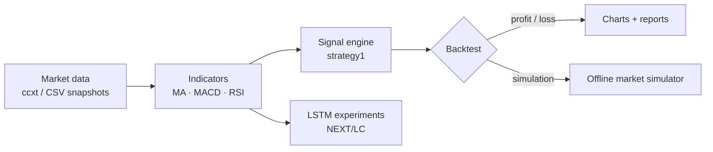

# TradingBot


An experimental bot for analysing crypto markets and backtesting a simple moving-average strategy. This is a **learning and research project, not a production trading system** — no real orders are ever placed.

## Pipeline



## Layout

| File / folder | Contents |
| --- | --- |
| `Funcations.py` | Technical indicators (MACD, RSI) and helpers on pandas DataFrames |
| `get_signal_MovingAverage.py` | `strategy1`, based on moving averages |
| `MarketAnalysisOnline.py` | Live analysis: exchange data through `ccxt`, animated Matplotlib chart |
| `Offline/` | The same pipeline on simulated prices (`MarketSimulation.py`, `MarketAnalysisOffline.py`) |
| `NEXT/` | Notebooks and experiments: exchange connectivity, LSTM models (`LC/`), arbitrage ideas (`workout/`) |
| `ProgramTest.py` | Entry point for a test run |
| `PriceData/`, `Save/` | Cached price data and results |
| `Document.pdf` | Project documentation (concept, structure, results) |

## Requirements

Python 3.10+ and:

```bash
pip install pandas numpy matplotlib ccxt
```

The notebooks in `NEXT/` additionally need the usual ML stack (Keras/TensorFlow).

## Run

```bash
python MarketAnalysisOnline.py                  # analysis on live market data
cd Offline && python MarketAnalysisOffline.py   # analysis on simulated data
```

## Data

`PriceData/` ships small CSV snapshots (`BTCUSDT`, `ETHUSDT`, `DOGEUSDT`, gold, silver, `AAPL`, `META`) so the offline pipeline runs without network access.

## Disclaimer

The strategy is intentionally simple (moving averages plus indicators) and exists to demonstrate data preparation, signal calculation and visualisation. Nothing here is investment advice.
